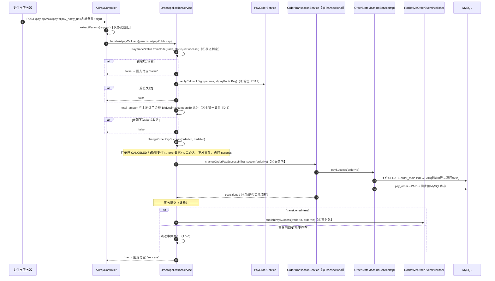

# 教材二：支付宝支付（Alipay Payment）

> **定位**：教学文档。设计事实以 [module-order-pay.md](module-order-pay.md) 为参考，本教材已按 [STUDY_GUIDE 附录 A](STUDY_GUIDE.md) 修正其口径（状态推进在回调事务内完成，MQ 侧仅为幂等确认 + 通知编排）。凡本教材与 module-order-pay 冲突，**以本教材（=代码事实）为准**。
> **配套关系**：对应 STUDY_GUIDE 阶段 2（Day 4）。超时关单、补偿 Job、库存一致性属 Day 6（教材四），本教材只在与回调链路交叉处做引用。
> **证据标记**：【代码推导】未实际运行；【文档实测】2026-10-07 E2E 首次通过、**2026-10-19 当前工作区全量复跑通过（17/17，C-1 销项）**；【待验证】需实验或官方文档确认。
> **学习目标**：学完能不看任何文档，画出"下单→唤起支付→异步回调→状态机→事务外发事件"全链路并用一条竖线标出事务边界，讲清四层幂等各自防什么，分析重复回调/伪造回调/金额不符/晚到支付四个异常场景。

---

## 1. 问题背景：在线支付到底难在哪

### 1.1 不用第三方支付，会怎样

商城系统自己收钱，意味着自己要处理：收谁的、收多少、怎么证明钱真的到了、到了之后谁来发货、用户说"我付了"但钱没到怎么办。每一道都是资金安全题。接入支付宝的本质是**把"钱的转移"委托给一个双方共同信任的清算方**，商城只处理"支付宝告诉我结果之后"的业务。

但委托引入了一个反转：**现在是你去请求支付宝，结果却是支付宝来通知你**。支付结果不再是你一次 HTTP 请求的响应，而是一个事后推送的 webhook。

### 1.2 为什么支付结果必须"异步通知 + 主动核实"，而不是同步返回

三个层面的原因：

1. **支付动作不在你的请求里闭环**。用户在你的页面点"去支付"后，流程转到支付宝收银台（扫码/输密码/确认），这个环节可能耗时几分钟，你的 HTTP 连接不可能一直挂着等。
2. **同步跳转不可信**。支付宝提供 `return_url`（用户付完跳回你的页面），但跳转可以被用户打断、篡改、伪造——**不能把"页面跳回来了"当作"钱到了"的证据**。本项目代码里 returnUrl 只作用户体验用，业务一律以 notify 回调为准（AlipayGatewayImpl L42 仅设置跳转地址，无任何业务消费）。
3. **网络会断**。用户可能在收银台付了钱，但回调在半路丢了。所以除了等回调，还必须能**主动向支付宝查**（本项目有 `AlipayQueryGatewayImpl.queryTradeSuccess`，Day 6 细讲）。

### 1.3 异步通知带来的三个安全问题

支付宝往你的服务器 POST 一个"支付成功"通知，攻击者也可以。所以回调处理必须回答：

- **这条通知真是支付宝发的吗？** → 验签（§2.4）。
- **这条通知的金额对吗？** → 验签只证明来源，不证明内容没被换包（如重放一条别的订单的合法通知）→ 金额一致性比对（TD-5）。
- **这条通知重复来了怎么办？** → 回调必须幂等（§4 状态机条件更新）。

这就是本教材的主线：**验签 → 金额 → 幂等 → 状态机 → 事件**，每一环对应一类真实攻击或故障。

---

## 2. 前置知识：支付宝协议与密码学常识

> 本节对应总纲 §四第 3 级。约 40 分钟。

### 2.1 支付产品形态（先看代码事实）

**本项目实际用的是电脑网站支付**，不是文档中偶称的"当面付"。证据：`AlipayGatewayImpl.generatePayUrl`（infra/order/gateway/AlipayGatewayImpl.java L38-60）用 `AlipayTradePagePayRequest` + `alipayClient.pageExecute(request)`，`product_code = "FAST_INSTANT_TRADE_PAY"`（电脑网站支付的产品码）——返回的是一段**自动提交的收银台 HTML 表单**，前端直接渲染/提交即可唤起支付。module-order-pay 中"当面付"表述与代码不符（轻微，口头更正即可）。

关键字段：`out_trade_no`（**商户订单号 = 我们的 orderNo**，全局业务主键）、`total_amount`、`subject`、`notify_url`（异步回调地址，配置注入 L33）、`return_url`（同步跳转地址，仅体验用）。

### 2.2 两个订单号，不要混

| 字段 | 谁签发 | 含义 | 本项目流向 |
|------|--------|------|-----------|
| `out_trade_no` | 我们 | 商户订单号，下单时生成 | 落 `order_main.order_no` / `pay_order.order_id`；回调里用它定位本地订单 |
| `trade_no` | 支付宝 | 支付宝侧交易流水号 | 回调里读出，随 `order_paid` 消息透传（`changeOrderPaySuccess(orderNo, tradeNo)`，OrderApplicationService L335），用于对账 |

面试点：补单路径（Job 主动查单）拿不到 `trade_no`，所以 `changeOrderPaySuccess` 的第二个参数允许为 null（NoPayNotifyOrderJob L92-93）——**设计接口时就考虑了"不是所有成功路径都有支付宝流水号"**。

### 2.3 异步通知（notify）协议要点

- 支付宝用 **POST 表单**向 `notify_url` 推送支付结果，参数含 `trade_status`、`out_trade_no`、`trade_no`、`total_amount`、`sign`、`sign_type` 等。
- 我们必须返回**纯文本 `"success"`** 表示处理成功；返回其他内容（包括异常 JSON），支付宝认为未受理并进入其侧重试。**重试的次数与间隔是支付宝平台协议参数，以官方文档为准**（module-order-pay 转述"24h/7 次"未经本轮核实 →【待验证 C-6】）。
- 因此回调处理必须**快速、幂等**：快速是因为支付宝在等响应；幂等是因为支付宝可能重发。

### 2.4 RSA2 验签的原理（讲到能给人讲明白为止）

非对称签名的一对角色：**支付宝用私钥签名，我们用支付宝公钥验签**。

1. 支付宝把回调的全部业务参数（剔除 `sign`、`sign_type`），**按参数名 ASCII 排序**后拼成 `k1=v1&k2=v2...` 的待签串；
2. 对该待签串做 SHA256 摘要，用支付宝私钥加密 → `sign`；
3. 我们收到后，用同样规则重建待签串，用支付宝公钥解密 `sign` 并比对摘要——一致则证明：**内容未被篡改 + 确实持有私钥的一方（支付宝）签发**。

精读这个逻辑在代码里的样子（`AlipayGatewayImpl` L63-118）：`getSignCheckContentV1`（L99-118）手工实现"排序 + 剔除 sign/sign_type + 跳过空值"，`rsa256CheckContent`（L80-85）做验签。面试可答的取舍点：SDK 其实提供 `AlipaySignature.rsaCheckV1` 一把梭，本项目手工拼串可能源于课程模板的兼容性考虑——**手工实现必须保证与支付宝规则逐字节一致，否则出现"真实回调验签失败"的致命排障**（本项目 E2E 用同规则构造签名正是为了锁定这一致性，见 §6-E3）。局限：无时间戳/nonce 防重（验签通过的通知可被原样重放，靠 §4 的业务幂等兜底）【代码推导】。

### 2.5 trade_status 语义与"算成功"的规则

支付宝回调用 `trade_status` 表达交易状态。本项目把"哪些状态算支付成功"收敛在一个枚举里（P0-6，Trigger 层不再有 trade_status 字符串判断）：

`PayTradeStatus`（domain/order/model/vo/PayTradeStatus.java）：

| 状态 | 含义 | isSuccess |
|------|------|-----------|
| WAIT_BUYER_PAY | 交易创建等待付款 | false |
| TRADE_CLOSED | 交易关闭（超时/退款） | false |
| TRADE_SUCCESS | 支付成功 | **true** |
| TRADE_FINISHED | 交易完成（不可退款） | **true** |

**TRADE_FINISHED 也视为成功**是容易漏的点：不可退款的终态与成功等价，漏掉它会导致部分订单永不履约【代码推导：枚举 L17-19 + handleAlipayCallback L317-321】。

### 2.6 前置小结

回调处理的判定顺序由此可以确定（这就是 §4 代码的真实顺序）：**先判状态（是不是成功）→ 再验签（是不是支付宝）→ 再比金额（内容对不对）→ 再履约（状态机，幂等）→ 事务外发事件（通知下游）**。

---

## 3. 完整业务流程

### 3.1 时序图：从下单到唤起支付

```mermaid
sequenceDiagram
    autonumber
    participant U as 用户
    participant C as MallOrderController
    participant S as OrderApplicationService
    participant IGW as IIdempotentGateway(Redis)
    participant TX as OrderTransactionService【@Transactional】
    participant M as MallOrderServiceImpl
    participant PS as PayOrderService
    participant AGW as AlipayGatewayImpl
    participant DB as MySQL

    U->>C: POST /mall-api/v1/orders (address, requestId, JWT)
    C->>S: createOrder(userId, address, requestId)
    S->>IGW: tryAcquire(order_create, requestId, 24h)【L1 幂等】
    alt 同 requestId 重发且已完成
        S-->>C: 返回首次订单(payUrl 为空，前端走 continue-pay 重新取支付链接)
    else 未处理过
        S->>TX: createOrderInTransaction(userId, address)
        TX->>M: listCart + checkAndDeductStock【库存三层检查，教材四】
        M-->>TX: deductedItems（Redis 已预扣）
        TX->>M: buildAndSaveOrder → INSERT order_main + order_item
        TX->>PS: generatePayUrl(payOrder)【WAIT_PAY 状态守卫】
        PS->>AGW: pageExecute → 收银台 HTML
        TX->>DB: INSERT pay_order (WAIT_PAY)
        TX->>M: clearCart(userId)
        TX-->>S: OrderCreateVO(orderNo, payUrl)
        Note over S: ——— 事务提交（竖线）———
        S->>S: sendDelayCloseMessage(orderNo)【事务外，30min 延时消息】
        S->>IGW: markDone(order_create, requestId, orderNo)
        S-->>C-->>U: orderNo + 收银台 HTML
    end
```

三个精读点：
1. **L1 幂等在事务外**（`OrderApplicationService.createOrder` L169-217）：requestId 为键 SETNX 24h，`PROCESSING` 与"结果值 orderNo"分态——处理中重发抛"请勿重复下单"，已完成后重发直接返回首次订单。异常时 `release` 幂等键允许用户重试（L212-216）。
2. **pay_order 以 WAIT_PAY 落库且始终如此**（OrderTransactionService L71-72 注释）：唤起支付宝不改落库状态——"用户打开收银台"不等于"用户付了钱"。超时关单与补单查询都以 WAIT_PAY 为准。
3. **延时关单消息在事务提交后发送**（L200-205），失败仅 warn——它的兜底在 Day 6（Job 40min），本节记住"发送在事务外"即可。

### 3.2 时序图：异步回调处理（本教材核心）



**一条竖线画在"事务提交"处**（Day 4 闭卷必考）：竖线左侧（状态判定/验签/金额校验/事务内状态机）要么全做要么全不做；竖线右侧（发事件）失败不影响左侧已提交的结果——这正是 STUDY_GUIDE §八场景 2 缺口的来源，也是 outbox（U-2）要补的位置。

### 3.3 四层幂等防御总表（背诵骨架，理解每一层防谁）

| 层 | 机制 | 位置 | 防什么 | 去掉它会怎样 |
|----|------|------|--------|--------------|
| L1 | requestId SETNX 24h（PROCESSING/结果分态） | OrderApplicationService.createOrder L169-217 | 重复下单（网络重试/双击/刷新重发） | 同一购物车被下出两个订单 |
| L2 | `order_main.order_no` 唯一索引 | DB 约束 | L1 失效时的最终兜底 | 并发双插成功 → 重复订单落库 |
| L3 | 状态机条件更新（UPDATE ... WHERE status=INIT，影响 0 行即跳过） | OrderStateMachineServiceImpl.paySuccess L51-56 | 支付宝重复回调/并发回调 | 重复履约：重复扣 DB 库存、重复发事件 |
| L4 | 事件仅在实际流转后发布（TD-6）+ 消费端 SETNX | changeOrderPaySuccess L380-384；OrderPaidRocketListener | 重复回调导致下游收到重复消息 | 下游重复消费（虽有消费幂等，但噪音与竞态增加） |

注意 L1/L2 属于"下单"侧，L3/L4 属于"回调"侧——面试问"你们的幂等怎么做的"，先问清对方指哪一侧再分层作答，这个澄清动作本身加分。

---

## 4. 源码精读（按执行顺序）

### 4.1 下单编排与幂等守门

**`OrderApplicationService.createOrder()`**（application/OrderApplicationService.java L169-217）
- L171-175：幂等键 = requestId（无 requestId 时降级 `uid:{userId}`，TTL 仅 10s，只防双击，**不承诺跨请求幂等**——注意这个降级语义，面试可能被问"前端不传 requestId 呢"）。
- L176-194：获取锁失败 → 若已完成（值 ≠ PROCESSING）→ 查首次订单返回（**payUrl 为空**，前端走 `continue-pay` 重新生成支付链接，OrderApplicationService.continuePay L238-241）；若处理中 → 抛"请勿重复下单"。
- L198-210：事务方法 → 事务外发延时消息 → `markDone` 记录 orderNo（同 requestId 重发时返回它）。
- L212-216：异常 → `release` 幂等键 → 重抛。精读点：**执行失败必须释放幂等键**，否则该用户 24h 内无法再下单（键值卡在 PROCESSING）。

### 4.2 事务内：订单与支付单

**`OrderTransactionService.createOrderInTransaction()`**（L61-90）
- 内容顺序：读购物车 → 库存预扣（`checkAndDeductStock`，三层检查见教材四）→ 落 order_main/order_item → `generatePayUrl` → 落 pay_order(WAIT_PAY) → 清购物车。
- L82-89 catch：**先回补 Redis 预扣库存，再重抛原异常**——DB 事务回滚不自动归还 Redis 预扣，必须手工回补；回补失败仅 error 日志（人工兜底）。

**`PayOrderService.generatePayUrl()`**（domain/order/service/PayOrderService.java L36-55）
- L37 状态守卫：`!canPay() && status != WAIT_PAY` 才拒绝——放行"内存中刚创建"的实体。
- L41-54：委托 `IPayGateway.generatePayUrl`（AlipayGatewayImpl），**失败时 `payOrder.markFailed()` 后重抛**——支付单状态机入口的唯一性（M2-2：支付单流转只允许经本服务）。

**`AlipayGatewayImpl.generatePayUrl()`**（infra/order/gateway/AlipayGatewayImpl.java L38-60）：§2.1 已精读。补一点：它所在类注释自称"防腐层（ACL）"——Domain 的 `IPayGateway` 隔离了支付宝 SDK 的全部细节（pageExecute/产品码/字段名），SDK 升级只动这一个类。

### 4.3 回调四步判定

**`AliPayController.payNotify()`**（trigger/http/AliPayController.java L43-56）
- 只做两件事：参数提取（`extractParams` L64-71）、回传 `"success"`/`"false"`。Javadoc 明确（L36-38）：**Controller 无 trade_status 判断**（P0-6 下沉的成果）。

**`OrderApplicationService.handleAlipayCallback()`**（L315-359），四步：
1. **状态判定**（L316-321）：`PayTradeStatus.fromCode(...)` 为空或非成功 → return false（回 "false"，支付宝会再试——对 WAIT_BUYER_PAY 这类中间态，让它重试是对的）。
2. **验签**（L323-330）：失败打 error（含公钥长度等排障信息）→ false。
3. **金额校验**（L339-355，TD-5）：`callbackOrder != null` 时才比对——**订单不存在时跳过金额校验**（无法比对），继续走第 ④ 步，由事务内的"查无订单 → warn → 不发事件"收尾，且最终仍回 success。金额不一致或 `NumberFormatException` → false（让支付宝重试；这是错账保护：宁可不履约也不错误履约）。比较用 `BigDecimal.compareTo` 而非 `equals`——规避 `0.10` vs `0.1` 的标度差异，面试点。
4. **履约**（L357）：`changeOrderPaySuccess(orderNo, alipayTradeNo)`。

**`OrderApplicationService.changeOrderPaySuccess()`**（L369-392）
- L373-377 **晚到支付守卫（B2）**：订单已 CANCELED → error 日志标记人工核实（退款或补履约）→ return。**注意此时 handleAlipayCallback 的返回值仍是 true**（L357 之后 L358 return true）——即对支付宝回 success 终止其重试，因为重试只会重复进入同一路径。
- L380：事务内状态推进，得到 `transitioned`。
- L381-384（TD-6）：未流转（重复回调/订单不存在）→ 跳过事件发布。这是"事件不重复"的关键：`E2E 断言同一回调重放 3 次、order_paid 计数恰为 1"【文档实测，2026-10-19 已复跑通过】。
- L386-391：事务外发事件，失败仅 warn——**STUDY_GUIDE §八场景 2 的缺口就在这两行与 Publisher 的 catch-all**。

### 4.4 事务内：状态机（幂等的权威实现）

**`OrderTransactionService.changeOrderPaySuccessInTransaction()`**（L102-112）：先按 orderNo 查 order_main，存在则走状态机；不存在 → warn + return false（legacy 旧链已下线，不回抛异常）。

**`OrderStateMachineServiceImpl.paySuccess()`**（domain/order/service/impl/OrderStateMachineServiceImpl.java L36-66），四步：
1. L39-43：查订单，不存在 → false。
2. L45-48：`order.canPay()` 状态守卫（INIT 才允许）→ 已 PAID 的重复回调在这里被拦。
3. L51-56：**条件更新** `updateOrderStatusByOrderNo(orderNo, INIT.toDbStatus(), PAID.toDbStatus())`——UPDATE 带源状态条件，**影响行数 0 = 并发事务已流转，直接 return false**，后面的副作用（pay_order、DB 库存）全部跳过。这是"并发回调重复扣库存"（P0-9）的修复核心：**把"判断+更新"合成一条原子 SQL，消除 check-then-act 竞态**。
4. L59-62：pay_order→PAID + `syncDBStockForPaySuccess`（遍历订单项做 DB 乐观锁扣减，`decreaseStock` 影响 0 行仅 warn 不回滚——Redis 预扣已成立，DB 失败属可告警的最终一致缺口）。

状态机其余流转同理（`deliver` L100、`complete` L130、`cancel` L151，均条件更新 + 守卫），教材四再对比。

---

## 5. 异常与边界场景

**场景 A：支付宝重复通知（含并发通知）**
路径：第二次回调进入 handleAlipayCallback → 验签/金额仍通过 → `changeOrderPaySuccess` → 事务内状态机 → `canPay()` false 或条件更新影响 0 行 → `transitioned=false` → **不发事件** → 回 success。结论：任意多次重复回调，DB 副作用恰好执行一次、事件恰好发布一次（TD-6）【代码推导；E2E 重放断言为文档实测，2026-10-19 已复跑通过】。

**场景 B：伪造回调（无签名/篡改参数）**
验签失败 → false → 支付宝收到 false（真实支付宝会重试，攻击者得不到任何状态变更）。注意边界：验签**不防重放**（一条合法通知可原样再发）——重放由场景 A 的幂等消化【代码推导】。

**场景 C：金额不符（伪造/错账/币种单位错误）**
`compareTo != 0` → false，不履约，等支付宝重试。**问：万一本地订单金额本身就是错的呢？** 那是下单侧 bug，回调侧的职责是"不匹配就拒绝"，把不一致暴露出来而不是吞掉（静默履约才是资损）【代码推导】。

**场景 D：回调到达但本地查无订单**
跳过金额校验（L341-355）→ 事务内查无 order_main → warn → false（不发事件）→ 回 success。设计意图：不阻塞支付宝的重试语义，同时不把不存在订单"履约"出来。残余问题：这类回调没有告警聚合，排查靠翻日志【代码推导】。

**场景 E：晚到支付（订单已 CANCELED，钱已收）**
见 §4.3 B2 守卫：不履约、不发事件、回 success、error 日志 + 人工核实（退款或补履约）。**为什么回 success**：支付宝的重试只会重复进入同一路径，不如终止；**为什么不自动退款**：退款是资金操作，无人工确认不自动做——这是资金系统的保守主义【代码推导】。

**场景 F：回调处理中途我们的事务失败**
异常穿透（无 catch）→ `GlobalExceptionHandler` 返回 0001 JSON（HTTP 200）→ 支付宝收到非 success → 其侧重试（参数以官方文档为准，C-6）→ 下次重试重新走全流程（幂等保证安全）。**另有第二道兜底**：Job 每 30s 扫 `pay_order = WAIT_PAY 且创建超 5min`（`IOrderDao.queryNoPayNotifyOrder`，L63-64），主动查支付宝并补履约——即使支付宝的回调全部丢失也能收敛【代码推导】。

**场景 G：事务成功但事件发送失败**
即 STUDY_GUIDE §八场景 2：订单 PAID 正确，消息不存在，通知丢失，无自动补偿（补单 Job 只扫 WAIT_PAY，扫不到已 PAID 单）。**本教材只标边界，论证与演进（outbox/U-1）在教材四与 STUDY_GUIDE §八**。

**场景 H：支付中途用户关了页面**
无任何回调（WAIT_BUYER_PAY 不会推送给我们作为成功）→ 30min 延时消息关单（Day 6）→ 库存恢复。pay_order 保持 WAIT_PAY 直至关单，期间用户可从订单列表 continue-pay 重新唤起收银台【代码推导】。

---

## 6. 动手实验

> 依赖真实环境：MySQL/Redis/RocketMQ（E2E 测试标注的端口为 MySQL 23306 / Redis 26379 / RocketMQ 9876，见 AlipayNotifyE2EIT 头注释）。E3 需要本机 Maven（sdkman）。

**E1｜下单看四张"底牌"（15min）**
账密登录后下单：查 `order_main`（状态 INIT）、`pay_order`（状态 **WAIT_PAY**）、Redis `mall:product:stock:{id}`（减少）、购物车已清空。再查 Redis `stock:event:order_create:{requestId}` = orderNo（markDone 结果值）。
验证点：§3.1 的"事务内四项写入 + 事务外两步"，以及 pay_order 落库即 WAIT_PAY。

**E2｜沙箱真实回调（20min）**
支付宝沙箱买家账号完成一笔支付：观察日志顺序"支付回调，消息接收 trade_status:TRADE_SUCCESS" → "验签通过" → 金额一致 → "【状态机】处理支付成功" → "已发送支付成功消息到 RocketMQ"。DB 复核：order_main=PAID、pay_order=PAID、DB 库存已扣。若未配沙箱，用 E3 代替。
验证点：四步判定顺序与事务边界竖线。

**E3｜跑通/读懂 AlipayNotifyE2EIT（30min）**
这是本系统最有价值的测试资产。跑：`mvn verify -Dtest=AlipayNotifyE2EIT`（环境就绪时；否则通读）。精读它的 mock 设计（测试类头注释 L54-64）：**测试自生成 RSA 密钥对，用 DynamicPropertySource 把 `alipay.alipay_public_key` 覆盖为测试公钥，再按 `getSignCheckContentV1` 的完全相同规则构造待签串并用测试私钥签名——生产验签代码原样执行，没有绕过**。
验证点：理解"为什么要如此大费周章"——验签逻辑本身就是要被测的对象。

**E4｜重复回调断言（随 E3，或手工重放）**
E2E 场景 2 的核心断言：同一回调重放，独立 consumer group 收到的 `order_paid` 计数**恰为 1**（TD-6）。手工等价做法：把 E2 收到的原始回调用相同签名重发 3 次，观察 Redis/DB 无副作用、事件只发一次。
验证点：场景 A 全链路。

**E5｜篡改金额看拒绝（15min）**
构造签名合法但 `total_amount` 被改的回调（本地用 E3 的测试密钥对方法），POST 后应：验签通过 → 金额不一致 → 响应 false → 订单状态不变。
验证点：TD-5 的存在意义——验签之后为什么还要比金额。

**E6｜错误私钥签名（10min）**
用另一对密钥签名发送回调：应验签失败 → false → 无任何状态变更。
验证点：场景 B。

---

## 7. 设计取舍

### 7.1 条件更新 vs 悲观锁 vs 先查后改

- **先查后改**（`if status==INIT then update`）：两条 SQL 之间存在竞态窗口，两个并发回调都能通过检查——P0-9 修复前的真实缺陷。
- **悲观锁**（`SELECT ... FOR UPDATE`）：可行，但持锁到事务提交，热点订单行会串行化回调。
- **条件更新**（本项目）：`UPDATE ... SET status=PAID WHERE order_no=? AND status=INIT`，把判断与更新原子化，影响行数即"我是否赢得了这次流转"。无锁、无额外往返、天然幂等。**这是本教材最该带走的一个模式**。

### 7.2 事件发布为什么在事务外（以及代价）

- 理由：MQ 发送是网络调用（3000ms 超时，P1-4），放事务内会拉长事务持锁时间；且事务内发送时"消息可能先于提交被消费"，消费端读到未提交状态。
- 代价：提交与发送之间出现崩溃窗口 → 消息丢失（场景 G）。根治需要 outbox（事务内写消息表，Job 异步投递，U-2 未实现）；当前靠"缺口影响仅限通知"（P1-P3 前提）成立。
- 面试表述：先说"提交后发送"，被追问"丢了怎么办"就答场景 G + U-2，**不要假装有 outbox**。

### 7.3 金额校验放在验签之后、事务之前

顺序理由：验签失败说明来源不可信，比金额毫无意义；金额不符说明内容不可信，不能进事务。**先廉价后昂贵**：状态判断（纯内存）→ 验签（CPU）→ 查库比金额（IO）→ 事务（锁）。每步失败都尽早 short-circuit。

### 7.4 手工待签串 vs SDK 现成方法

见 §2.4。补充：手工实现的维护风险是"与支付宝规则漂移"（如支付宝调整空值参数处理）；E2E 的同规则构造签名实际是这条风险的锁定测试。升级方向：改用 `AlipaySignature.rsaCheckV1`（待排期，未登记）。

### 7.5 notify_url 的公网可达性（部署常识）

支付宝回调必须从公网到达你的 `notify_url`。课程项目历史上用过内网穿透（natapp，git 早期提交可见），后去除——本地联调可用沙箱 + 穿透工具，答辩演示环境务必提前验证回调可达。这属于"代码之外但答辩会翻车"的工程点【待验证：当前演示环境的回调链路】。

---

## 8. 面试与答辩

### 8.1 基础题

**Q1：为什么必须验签？不验签会怎样？**
A：notify 是公网端点，任何人都能 POST 一个"支付成功"。验签（支付宝公钥 + RSA2）证明回调确实由持有私钥的支付宝签发且内容未被篡改。不验签 = 把订单状态机交给陌生人（§2.4 的待签串规则可展开）。

**Q2：验签通过了，为什么还要比对金额？**
A：验签只保证"这是支付宝发的、内容没被改过"，不保证"这笔通知对应你期望的那笔交易"——重放一条别的订单的合法通知同样验签通过。比金额（compareTo，TD-5）把"内容对不对"补上。不一致宁可拒绝履约等重试，也不错误履约。

**Q3：TRADE_SUCCESS 和 TRADE_FINISHED 都要处理吗？**
A：都要。`PayTradeStatus` 中两者 isSuccess=true（L17-19）。TRADE_FINISHED 是不可退款的终态，漏处理会导致这部分订单永远停在 INIT。

**Q4：回调为什么要快速返回 success？**
A：支付宝在等待响应，超时/非 success 会触发其侧重试（参数以官方文档为准）。所以重活（履约）必须幂等且快速；不能"回调里发货"——发货失败不应阻塞支付确认的返回，这正是 MQ 存在的理由（接教材三）。

### 8.2 连续追问

**Q5：同一个回调来 10 次，系统里会发生什么？**
A：全链路：每次都通过状态判定/验签/金额校验（都是只读或无副作用）→ 事务内状态机：第一次条件更新成功（INIT→PAID），后 9 次 `canPay()` 拦截或影响行数 0 → `transitioned=false` → 不发事件 → 回 success。净效果：DB 恰好一次变更、事件恰好一次发布（E2E 断言计数=1）【文档实测，2026-10-19 已复跑通过】。

**Q6：事务边界画在哪？为什么金额校验在事务外？**
A：竖线在 `changeOrderPaySuccessInTransaction` 的提交点。验签/金额校验在事务外——它们失败时不该持有 DB 锁，也不该把"校验失败"混进回滚语义；状态推进必须在事务内——order_main、pay_order、DB 库存三个写入要么全成要么全不做（§3.2 竖线）。

**Q7：订单已关闭又收到支付成功通知呢？（晚到支付）**
A：B2 守卫：error 日志 + 人工核实退款/补履约，不履约、不发事件，但回 success 终止支付宝重试。关单侧的三道防线（延时消息/二次确认/兜底 Job）在教材四讲——这里的重点是"显式异常路径，不静默"。

**Q8：pay_order 为什么一直 WAIT_PAY？用户已经打开收银台了啊。**
A：打开收银台只是渲染了支付宝的支付表单，钱还没动。落库状态只反映"我们与支付宝之间的账务状态"，PAYING 仅是内存实体状态（OrderTransactionService L71-72 注释）。这条口径能答出来说明你区分了"用户界面状态"和"账务状态"。

**Q9（深挖）：`changeOrderPaySuccessInTransaction` 里先查一次 order_main，状态机里又查一次，不冗余吗？**
A：外层查询决定"走新链还是 legacy 分流"（legacy 已下线，查不到记 warn）；状态机内的查询装载实体做 `canPay()` 领域判断。两次查询之间无写操作，一致性无风险；若极致优化可透传，但分层清晰度收益更大。这道题考的是"敢不敢为分层付一次查询的代价"【代码推导】。

### 8.3 答辩口径提醒

- 被问"履约是不是 MQ 做的"：**状态推进在回调事务内同步完成，MQ 承载的是支付成功后的异步通知处理**（STUDY_GUIDE 附录 A-4 口径，高危点）。
- 被问"消息会不会丢"：主动讲场景 G 缺口 + U-2 outbox 演进，不遮掩。
- 被问"你实现了什么支付"：按代码答"支付宝电脑网站支付（收银台 HTML 表单）"，文档中的"当面付"表述以代码为准更正。

---

## 9. 闭卷验收

**验收 A｜画图（25min）**
不看资料画出 §3.2 回调时序图：① 四个判定步骤齐全且顺序正确；② 事务边界竖线位置正确，竖线左右内容各写对一半以上；③ 标出 `transitioned=false` 的两条来源（重复回调/订单不存在）。

**验收 B｜四层幂等表默写（10min）**
默写 §3.3 总表（层/机制/位置/防什么/去掉后果），并口头补充 L1 的降级语义（无 requestId 时 uid 短锁 10s）。

**验收 C｜源码定位（15min）**
5 个行为写出类+方法+行号：① 条件更新并发守卫；② 金额一致性校验；③ 事件仅流转后发布；④ pay_order WAIT_PAY 落库口径；⑤ 晚到支付守卫。
（答案：①OrderStateMachineServiceImpl.paySuccess L51-56；②OrderApplicationService.handleAlipayCallback L341-355；③changeOrderPaySuccess L380-384；④OrderTransactionService L71-72；⑤changeOrderPaySuccess L373-377。）

**验收 D｜场景口述（20min）**
抽签 4 个（必须含 A 重复回调、E 晚到支付、G 事务成功发送失败）：按"现象→代码依据→后果→缓解→遗留缺口"五步口述；G 必须正确转述 STUDY_GUIDE §八场景 2 的边界（只扫 WAIT_PAY 的 Job 扫不到它）。

**验收 E｜事务边界快问快答（10min）**
被问 6 个动作各自在事务内还是外：验签/金额校验/状态机推进/pay_order 更新/DB 库存扣减/发 order_paid 消息/发延时关单消息。全对才算过（答案：外/外/内/内/内/外/外）。

---

> **学完标志**：验收 A-E 全过。下一步：LEARN_ROCKETMQ.md（Day 5，你的重点教材）。遗留待验证项：C-6（支付宝重试参数官方文档）。（C-1 E2E 复跑、C-7 微信登录安全实验均已于 2026-10-19 完成/销项。）
