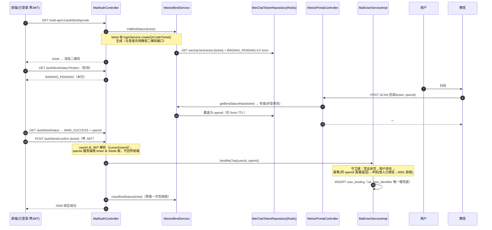

# 教材一：微信扫码登录（WeChat QR Login）

> **定位**：教学文档。设计事实以 [module-auth.md](module-auth.md) 为参考，但本教材已按 [STUDY_GUIDE 附录 A](STUDY_GUIDE.md) 修正其两处口径错误（Redis 存的是 JWT 不是 openid；ticket 请求值为 2592000s）。凡本教材与 module-auth 冲突，**以本教材（=代码事实）为准**。
> **配套关系**：对应 STUDY_GUIDE 阶段 1（Day 2~3）；总纲 §四第 3 级前置知识"微信开放平台协议"由本教材 §2 承担。
> **证据标记**：【代码推导】未实际运行；【文档实测】2026-10-07 E2E 首次通过、**2026-10-19 当前工作区全量复跑通过（17/17，C-1 销项）**；【待验证】仅剩 C-3（沙箱真实回调，需外网）；附录 D 两项风险已于 2026-10-19 实测确认（C-7），其中 D-2 已登记 S-06 并修复。
> **学习目标**：学完能不看任何文档，画出登录与绑定两条时序图、逐步指到源码行、讲清每个凭证的签发者/消费者/有效期/存储位置、分析 §5 全部异常场景。

---

## 1. 问题背景：这个技术解决什么业务问题

### 1.1 不用扫码登录，会怎样

本系统是一个商城，用户要下单就必须先"证明你是谁"。证明身份的经典方式是账密登录，但账密有真实的产品痛点：

- 用户要**记住并输入**密码——每多一次输入，流失一批用户；
- 密码会被**泄露、撞库、弱密码**——安全成本随用户量上升；
- 新用户**注册有摩擦**——填用户名、想密码、验证邮箱，任何一步都可能放弃。

微信扫码登录把"证明你是谁"委托给微信：用户用已登录的微信客户端扫一下二维码，微信替你完成身份断言。对商城来说，接入成本是认证的公众号 + 两次 HTTP API。

### 1.2 但"扫码"引入了一个新问题：异步鸿沟

账密登录是**同步**的：浏览器发请求 → 服务器验证 → 返回 token，一个请求闭环。

扫码登录是**异步**的，参与者有三方：

```
浏览器（用户在电脑前）          微信客户端（用户拿手机）         微信服务器
   |                                |                            |
   |── ① 展示二维码 ───────────────→│                            |
   |                                │── ② 扫码 ────────────────→│
   │                                │                            │── ③ POST 回调我们的服务器
   │◄─────────────────────────────────────────────────────────│
   │   ④ 浏览器怎么知道"用户扫了"？！                              │
```

关键断裂在第 ④ 步：微信服务器回调的是**我们的后端**，而等着结果的是**用户的浏览器**。后端收到回调时，浏览器连接早就断了（它只发了"取二维码"那个请求）。**如何让浏览器得知一个发生在"另一个通道"（微信→后端）的事件，是扫码登录的核心设计问题。** 本项目的答案：Redis 中转 + 短轮询（§3 细讲）。先记住这个骨架，后面所有代码都是在填它的细节。

### 1.3 本系统不止"登录"：两套身份，一个账户

本系统同时存在两种登录方式（账密 / 微信扫码），它们必须能登录**同一个**账户——否则一个用户在手机上扫码下的单，电脑上账密登录看不到。这个"身份合并"问题由"账号绑定"解决（§3.3）。学习时把两个问题分开：**登录**（拿到会话）与**绑定**（把两种身份映射到同一 userId），是两个独立的链路，只是恰好共用微信侧的凭证。

---

## 2. 前置知识：先分清五个凭证

> 本节对应总纲 §四第 3 级。学完后应能默写 §2.5 的凭证五列表。不要跳过——后面源码里每个方法，本质上都在搬运这五个凭证之一。

### 2.1 微信侧的身份与凭证（原理）

**access_token：调用微信 API 的"门票"**

微信公众号后台的几乎所有 API 都需要 access_token 来证明"这个调用来自哪个公众号"。它由微信签发（`appid + appsecret` 换取），默认有效期 7200 秒（2 小时），有调用频率限制。它是**应用级**凭证——不代表任何用户，只代表"你的公众号"。

**带参数二维码 ticket：一次扫码活动的"门牌号"**

公众号可以生成"带场景值"的二维码。你向微信请求"给我一个二维码，里面编码 scene_id=100601"，微信返回一个 ticket；用 `https://mp.weixin.qq.com/cgi-bin/showqrcode?ticket={ticket}` 即可展示二维码。用户扫码后，微信服务器向我们配置的回调地址推送一个事件，事件里带**同一个 ticket** 和扫码用户的 **openid**。ticket 的作用：把"浏览器那次取二维码的请求"与"微信后来那次扫码回调"**关联起来**——没有 ticket，后端收到扫码回调时根本不知道这次扫码对应哪台浏览器。

**openid：用户在某公众号下的唯一标识**

用户每关注/交互一个公众号，微信分配一个 openid。它是**用户级但应用级隔离**的标识：同一个微信用户，在不同公众号下 openid 不同。

**UnionID：跨应用统一标识（本项目未使用，但面试常问）**

如果同一开发者把多个应用（公众号、小程序、APP）绑定到微信开放平台，微信会为该用户在所有这些应用下分配**同一个 UnionID**。本项目只用了一个公众号，所以只有 openid；面试答"需要跨应用识别同一用户时才需要 UnionID，需绑定开放平台"。

### 2.2 系统侧的凭证（原理）

**JWT：我们自己的会话凭证**

登录成功后，系统要发给浏览器一个"以后每个请求都带上它"的凭证。本项目用 JWT（JSON Web Token）：服务器用密钥签名一段 JSON（含 userId/username/role），浏览器每次请求放在 `Authorization: Bearer {token}` 头里；服务器验签即可还原身份，**不需要存任何会话状态**（无状态）。代价：签发后无法主动作废（无黑名单机制——本系统接受这一点）。

**Redis：凭证的"中转仓"**

扫码登录需要临时存放两类东西：微信的 access_token（110 分钟）、ticket→JWT 的映射（5 分钟）。为什么用 Redis 而不用 JVM 内的 `Map` 或 Guava Cache——这是本教材最重要的"演进史"问题，留到 §7.2 用 Git 史实讲透。先记住结论：**本地缓存无法跨实例共享、进程重启即丢、TTL 不受统一控制，所以登录态中转必须用 Redis**。

### 2.3 原理层面再回答一个问题：为什么是"轮询"而不是"推送"

浏览器想知道扫码结果，理论上有三条路：

| 方案 | 原理 | 为什么本项目（不）选 |
|------|------|----------------------|
| 短轮询（本项目） | 浏览器每 3s 问一次后端"好了吗" | 实现最简单、无状态、防火墙/代理全兼容；代价是少量空请求 |
| SSE / 长连接 | 后端持有连接，有结果主动推 | 连接管理复杂（代理超时、心跳、多实例时还要路由到持连接的实例）；登录是一次性低频交互，不值得 |
| WebSocket | 全双工长连接 | 同 SSE，且更重 |

面试追问"为什么不用 WebSocket"时，先答"场景是短时一次性交互"，再补一句"若扫码后要维持长会话（如聊天），才值得上长连接"。

### 2.4 原理小结：三类角色、五次搬运

```
微信签发： access_token（2h）─── 我们缓存到 Redis（110min，提前续期）
           ticket（30 天）   ─── 我们只用它当 Redis key，安全由 5min 兜底
           openid           ─── 只出现在 SCAN 回调里，不落 Redis 登录态（A-1 修正点）
我们签发： JWT            ─── 存 Redis（key=ticket，5min，一次性消费），被轮询取走后到达浏览器
浏览器持有： JWT          ─── 之后所有请求的 Authorization 头
```

### 2.5 凭证五列表（闭卷默写目标）

| 凭证 | 签发者 | 存储位置与 Key | TTL（代码值） | 消费者 |
|------|--------|----------------|----------------|--------|
| access_token | 微信 API（`cgi-bin/token`） | Redis `wechat:access_token:{appid}`（Constants.REDIS_WECHAT_ACCESS_TOKEN_PREFIX） | 缓存 110min（微信原始有效期 7200s，提前 10min 续期） | 后端调微信 API 时携带 |
| ticket | 微信 API（`cgi-bin/qrcode/create`） | 仅作 Redis key 使用，不存 value | 请求值 2592000s（30 天，**A-2 修正点**） | 拼接二维码 URL；SCAN 回调匹配 |
| ticket→JWT | 后端（WeixinLoginGatewayImpl.saveLoginToken） | Redis，key = ticket 原文 | 5min | 前端轮询 `check_login` |
| openid | 微信（回调参数/XML） | **不落 Redis 登录态**；存 DB `user_binding` 表 | —（持久） | 后端反查 userId、发模板消息 |
| JWT | 后端（AuthTokenGatewayImpl.createToken） | 浏览器 localStorage；服务端无状态 | `security.jwt.expire-ms` 配置 | 每次请求的鉴权过滤器 |

---

## 3. 完整业务流程

### 3.1 时序图一：扫码登录主链路

```mermaid
sequenceDiagram
    autonumber
    participant U as 用户浏览器
    participant F as 前端 Vue
    participant C as LoginController
    participant GW as WeixinGatewayImpl
    participant R as Redis
    participant WX as 微信API
    participant P as WeixinPortalController
    participant APP as AuthApplicationService(@Transactional)
    participant S as WeixinLoginService
    participant DB as MySQL

    U->>F: 访问 /login 页
    F->>C: GET /pay-api/v1/login/weixin_qrcode_ticket
    C->>S: createQrCodeTicket()
    S->>GW: createQrCodeTicket()
    GW->>R: GET wechat:access_token:{appid}
    alt 缓存命中
        R-->>GW: accessToken
    else 未命中（首次/过期）
        GW->>WX: GET /cgi-bin/token?grant_type=client_credential
        WX-->>GW: {access_token, expires_in=7200}
        GW->>R: SET 110min
    end
    GW->>WX: POST /cgi-bin/qrcode/create (scene_id=100601, expire_seconds=2592000)
    WX-->>GW: { ticket }
    GW-->>C-->>F: Response(ticket)
    F->>U: 渲染二维码 showqrcode?ticket=...

    U->>微信: 手机扫码
    微信->>P: POST /weixin/portal/receive (SCAN 事件 XML, 带 ticket+openid)
    Note over P: 先查绑定状态（getBindStatusRaw）——<br/>绑定流程见 §3.3；无绑定态则走登录
    P->>APP: handleWechatScanLogin(ticket, openid)
    APP->>S: handleWechatScanLogin(ticket, openid)【事务内】
    S->>DB: 按 openid 查 user_binding
    alt 首次扫码（openid 未绑定）
        S->>DB: 自动注册：建 mall_user(temp_xxx)→改名 wx_user_{id}→插 user_binding→赋 MEMBER 角色
        S->>S: 签发 JWT
    else 老用户
        S->>S: 按 userId 签发 JWT
    end
    S->>R: SET {ticket}=JWT EX 5min
    S-->>APP-->>P: 返回（事务提交）
    P-->>微信: ""（空回复即成功）

    loop 每 3s 轮询
        F->>C: GET /login/check_login?ticket=
        C->>S: checkLogin(ticket)
        S->>R: GET {ticket} → 有值则立即 DEL
        alt 已写入
            C-->>F: Response(JWT, code=0000)
            F->>F: 停止轮询，存 localStorage，跳首页
        else 未写入
            C-->>F: code=0003(NO_LOGIN)
        end
    end
```

**逐步解释参与者的职责**（每一步问自己：它在搬运哪个凭证）：

1. **LoginController（Trigger）**：只做 HTTP 协议适配。`weixinQrCodeTicket()`（L42）把 ticket 包进统一 `Response`；`checkLogin()`（L70）拿到非空 token 返回 0000，为空返回 **0003（NO_LOGIN）**——前端靠区分 0000/0003 判断"还没扫"还是"扫了"。
2. **WeixinGatewayImpl（Infrastructure）**：唯一的微信 HTTP 出口（Retrofit2 声明式客户端 `IWeixinApiService`）。`createQrCodeTicket()`（L49-77）内部先 `getAccessToken()`（L135-152）再换 ticket——**ticket 请求值 `expire_seconds=2592000`、scene 固定 `100601`**（L55-63），这是 A-2 的代码事实。
3. **Redis**：两个 key——access_token（110min）与 ticket→JWT（5min），职责完全不同，不要混淆。
4. **WeixinPortalController（Trigger）**：微信事件推送的入口。`post()`（L93-135）解析 XML，识别 `MsgType=event + Event=SCAN`（L110）后**先做绑定分流**（L115-119：ticket 有绑定态 → 更新绑定并返回），否则进入登录（L122）。返回 `""` 表示微信侧接收成功。
5. **AuthApplicationService（Application）**：`handleWechatScanLogin`（L40-43）**整方法 `@Transactional`**——这是 P0-3 架构整改的成果，事务边界在 Application 层。
6. **WeixinLoginService（Domain）**：业务规则所在。`handleWechatScanLogin`（L50-84）：查绑定 → 未绑定走自动注册 → 签发 JWT → 存 Redis。
7. **MySQL**：`mall_user` + `user_binding` + `user_role` 三个写操作（自动注册时）。

### 3.2 时序图二：账号绑定（账密用户 ↔ 微信）

> 场景：用户已用账密登录（持有 JWT），想以后也能扫码登录**同一个账户**。



反向链路（微信用户补设密码）：`POST /auth/password`（L206）→ `setPassword()`：长度守卫 6~64 → BCrypt 更新 → **status 由 WECHAT 转 ACTIVE**，此后该账户账密/扫码皆可登录。

### 3.3 为什么 SCAN 回调里要先"尝试绑定"

一个 ticket 可能属于两种流程（登录二维码 or 绑定二维码）。系统用 Redis 里**有没有绑定态**来区分：`WeixinPortalController` L115 先查 `getBindStatusRaw(ticket)`，有值说明这是绑定二维码（此前 `/bind/qrcode` 初始化了 BINDING_PENDING），走绑定；查不到说明是登录二维码，走登录。这是一个"用状态存在性做隐式路由"的设计——简洁，但也意味着两种二维码在 Redis 层面互不感知（key 前缀不同：`{ticket}` vs `wechat:bind:ticket:{ticket}`）【代码推导】。

---

## 4. 源码精读（按执行顺序）

> 阅读方法：打开文件，先读方法签名与 Javadoc（注释是设计意图的第一手记录），再读方法体。路径前缀见 STUDY_GUIDE §七。

### 4.1 第一步：取二维码（浏览器 → ticket）

**`LoginController.weixinQrCodeTicket()`**（trigger/http/LoginController.java L42-59）
- 无入参，返回 `Response<String>`。注意 L52-58 的 catch：失败返回 UN_ERROR（0001），**前端要处理"二维码生成失败"的展示**。
- 委托 `ILoginService.createQrCodeTicket()`。

**`WeixinLoginService.createQrCodeTicket()`**（domain/auth/login/service/WeixinLoginService.java L39-42）
- 一行委托 `weChatGateway.createQrCodeTicket()`。Domain 层不感知 HTTP——DDD 端口/适配器的体现： domain 只依赖 `IWeChatGateway` 接口。

**`WeixinGatewayImpl.createQrCodeTicket()`**（infra/auth/login/gateway/WeixinGatewayImpl.java L49-77）
- L52：先取 `getAccessToken()`（见 4.2）。
- L55-63：构造 `WeixinQrCodeRequestDTO`，**`expire_seconds=2592000`（30 天）、`QR_SCENE`、`scene_id=100601L`（硬编码）**。两个追问点（30 天有效期的安全含义、固定 scene_id 不区分二维码用途）留到 §5 与附录 D。
- L65-72：Retrofit 调用 `createQrCode`，非空校验后返回 ticket。

**这一步的数据变化**：Redis 可能有 1 次 SET（access_token 缓存未命中时）；浏览器得到 ticket 字符串。

### 4.2 穿插：access_token 的缓存（Cache-Aside）

**`WeixinGatewayImpl.getAccessToken()`**（L135-152）
```java
String key = Constants.REDIS_WECHAT_ACCESS_TOKEN_PREFIX + appid;   // wechat:access_token:{appid}
String accessToken = stringRedisTemplate.opsForValue().get(key);
if (accessToken == null) {
    // 回源微信 API（grant_type=client_credential, appid, appSecret）
    stringRedisTemplate.opsForValue().set(key, accessToken, 110, TimeUnit.MINUTES);  // L148
}
```
- 模式：**Cache-Aside**（先查缓存，未命中回源并回填）。
- 为什么是 110min 而不是 120min：微信官方 7200s（120min），提前 10min 过期，**避免"缓存显示有效、微信侧已失效"的边界竞态**——面试高频点。
- 并发回源问题：两个请求同时未命中会都打微信 API。微信 token 接口有频率限制，但本项目规模下重复获取同 appid token 是无害的（token 本身幂等）。大规模场景应加锁（Redisson）或预刷新 Job——这是可以讲的"局限"【代码推导】。

### 4.3 第二步：SCAN 回调（微信 → 后端，异步鸿沟被填上的一半）

**`WeixinPortalController.post()`**（trigger/http/WeixinPortalController.java L93-135）

```java
if ("event".equals(message.getMsgType()) && "SCAN".equals(message.getEvent())) {   // L110
    String ticket = message.getTicket();
    String bindStatus = weixinBindService.getBindStatusRaw(ticket);                 // L115 绑定分流
    if (bindStatus != null) {
        weixinBindService.updateBindStatus(ticket, openid);                         // L117 写 openid
        return "";
    }
    authApplicationService.handleWechatScanLogin(ticket, openid);                   // L122 登录
    return "";
}
```

三个精读点：
1. **ticket 来自 XML 体，openid 来自 URL 查询参数**（`@RequestParam("openid")` L98）——微信把用户身份放 URL、把事件内容放 body。
2. **绑定优先于登录**（L115-119）。
3. **整个方法被 try-catch 包裹，任何异常都返回 `""`（L124-127、L131-134）**——微信收到空串视为接收成功、不再重推。后果分析见 §5 场景 D：回调处理失败的"静默失败"特征。

**关于验签的重要事实（附录 D-2，2026-10-19 已实测确认并修复）**：GET `validate()`（L55-76）有 `SignatureUtil.check` 验签（对照组实测：伪造签名 GET 被正确拒绝），而 **POST `post()` 在 S-06 修复前接收了 signature/timestamp/nonce 参数却没有验签**——以 `signature=fake` POST 伪造 SCAN 事件即可让系统为任意 openid 自动建户并签发 JWT（C-7a 全链路实测走通）。**现已在 post() 入口补充验签（S-06，SECURITY_ISSUES）**：修复后重放同一攻击实测被拒（验签失败 WARN、无 token、无用户创建）。

### 4.4 第三步：登录处理（事务内）

**`AuthApplicationService.handleWechatScanLogin()`**（application/AuthApplicationService.java L40-43）

```java
@Transactional(rollbackFor = Exception.class)
public String handleWechatScanLogin(String ticket, String openid) {
    return loginService.handleWechatScanLogin(ticket, openid);
}
```

- 方法体只有一行委托，但 `@Transactional` 是关键：**扫码自动注册涉及 4 个写操作**（建用户、改用户名、插绑定、插角色），必须在同一事务——P0-3 整改前这些写操作散落在 Infrastructure 层且Infrastructure 持有事务注解，属架构违规。
- 面试问"事务为什么在这层"：答"业务规则在 Domain，**用例编排+事务边界在 Application**——这是最小正确方案"。

**`WeixinLoginService.handleWechatScanLogin()`**（domain/auth/login/service/WeixinLoginService.java L50-84），按执行顺序：

| 行 | 动作 | 数据变化 |
|----|------|----------|
| L54 | `findUserIdByOpenid(openid)` | 查 `user_binding`（identity_type=WECHAT_MP, identifier=openid） |
| L57-62 | userId==null → **自动注册** | 调 `mallUserService.registerWeChatUserByScan(openid)` |
| L65 | 老用户 → `createToken(userId, "wx_user_"+userId, MEMBER)` | JWT 签发（HS256，载荷 uid/username/role） |
| L70 | `saveLoginToken(ticket, token)` | Redis：`SET {ticket} {JWT} EX 300` |
| L71 | `sendLoginNotificationBestEffort` | 微信模板消息（登录提醒），**失败仅记日志**（L97-103 catch），不回滚事务 |

**`MallUserServiceImpl.registerWeChatUserByScan()`**（domain/mall/user/service/impl/MallUserServiceImpl.java L85-103）——自动注册的"四步曲"：

```java
Long userId = createUser("temp_" + UUID(8位), "", USER_STATUS_WECHAT);  // L88：临时名占位拿自增ID
String username = Constants.WX_USER_USERNAME_PREFIX + userId;          // wx_user_{id}
userRepository.updateUsername(userId, username);                       // L91：固化用户名
userBindingGateway.bindWeChatOpenId(userId, openId);                   // L93：插绑定
String token = authTokenGateway.createToken(...);                      // L96：签发JWT
```

精读点：**为什么先建 temp 再改名**——用户名想带 userId，但 userId 是插入自增才产生的，所以"占位名插入 → 拿到 ID → 改名"是数据库自增主键下的常见手法（一次 UPDATE 换可读用户名）。`createUser()`（L113-122）内含三个公共步骤：查重 → BCrypt 加密插入 → 赋 MEMBER 角色（MEMBER_ROLE_ID=2L）。

### 4.5 第四步：轮询取 token（异步鸿沟的另一半）

**`LoginController.checkLogin()`**（L70-95）→ **`WeixinLoginService.checkLogin()`**（L44-47）→ **`WeixinLoginGatewayImpl.getLoginToken()`**（infra/auth/login/gateway/WeixinLoginGatewayImpl.java L46-54）：

```java
String token = stringRedisTemplate.opsForValue().get(ticket);
if (token != null) {
    stringRedisTemplate.delete(ticket);   // L51 读后即删：一次性消费
}
return token;
```

- **存的是 JWT 而不是 openid**（A-1 修正点）：轮询到值的浏览器可以直接用 JWT，不需要后端再补一次签发。这是"回调时多做一点（签发好 JWT），让轮询路径最薄"的设计。
- **读后删的语义**：同一 ticket 只能被取走一次。见 §5 场景 B 的竞态分析。

### 4.6 贯穿的认证链（登录之后的每个请求）

时序：请求 → `JwtAuthenticationFilter.doFilterInternal`（start/config/security/JwtAuthenticationFilter.java L54-81）解析 Bearer token → 成功则写入 SecurityContext（username + ROLE_{role}）→ **失败则 `clearContext()` 清空上下文（L75），请求继续走过滤器链** → `SecurityConfig`（L50-77）按 URL 规则裁决：白名单（登录/注册、商品浏览、`/pay-api/v1/login/**`、`/pay-api/v1/weixin/**`、支付宝回调）放行；`/admin/**` 要求 ADMIN 角色；其余要求认证 → 未认证由 AuthenticationEntryPoint 返回 **HTTP 401 + `{"code":"0003"}`**（S-02）→ Controller 内 `BaseController.currentUserId()` 从 JWT 再解析一次 userId 作为兜底（绑定 confirm、profile 等端点都靠它取 userId，**不从请求参数取**——防 IDOR）。

异常语义（S-03）：token 过期/签名错由 `GlobalExceptionHandler.onJwtException`（trigger/http/mall/GlobalExceptionHandler.java L124-129）归 0003 + 固定文案；兜底 `onException`（L143）不透传原始异常 message。

---

## 5. 异常与边界场景

> 每个场景按"现象 → 代码依据 → 后果 → 缓解"四步分析。这是答辩和面试的核心弹药。

**场景 A：用户一直不扫码 / ticket 过期**
现象：轮询始终 0003。代码依据：Redis 无 `{ticket}` key（SCAN 回调从未写入，或 5min TTL 已过期）。后果：前端 60s 后停轮询并提示刷新二维码（前端行为）。缓解：重新取 ticket 即可，无副作用。

**场景 B：同一 ticket 被轮询两次（重复请求/双击/两个标签页）**
现象：第一次取到 JWT，第二次 0003。代码依据：`getLoginToken` 读后删（L51）。**竞态窗口**：GET 与 DEL 不是原子操作，两个并发轮询可能都读到值（都返回 0000）——本系统接受这个小窗口（两个浏览器都拿到同一 JWT，后果是同一账户两个会话，非资金操作）【代码推导】。要严格原子应用 GETDEL（Redis 6.0+）或 Lua。面试能说出"读后删非原子"是加分项。

**场景 C：SCAN 回调时后端处理失败（如 DB 抖动）**
现象：`post()` 的 catch 返回 `""`（L124-127）→ 微信认为推送成功，**不重推** → 但 Redis 里没写入 token → 用户白扫了，轮询超时。代码依据：全方法 try-catch 吞异常。后果：体验问题（用户重扫一次即可），无资损。缓解缺口：无告警、无重试——可作为"局限"讲【代码推导】。微信对事件推送是否有重试机制属微信平台行为【待验证】。

**场景 D：自动注册途中进程崩溃**
现象：`@Transactional` 保证 4 个写操作整体回滚（不会出现"建了用户没绑微信"的脏数据）。但注意：**Redis 的 `saveLoginToken` 在事务方法内、却在 DB 事务保护之外**——若 token 已写入 Redis 而事务最终提交失败（极端：DB 连接在最后提交时断开），Redis 会残留一个指向不存在用户的 JWT（5min 过期，后果是该 ticket 轮询返回"幽灵 token"，后续请求因用户不存在而拿不到数据）【代码推导】。窗口极小，登记为已知边界即可。

**场景 E：access_token 缓存与微信侧不同步**
现象：微信侧提前失效（如运营在后台重置 secret）。代码依据：110min 缓存 vs 120min 官方有效期，有 10min 缓冲，正常不会撞上；若撞上，微信 API 返回错误，表现为取 ticket 失败 → 0001。缓解：重新触发回源即可（下次调用自动回填）。

**场景 F：绑定冲突（openId 已被他人绑定）**
现象：confirm 返回 0001"该微信账号已被其他用户绑定"。代码依据：`bindWeChat`（L252-254）先查 `isWeChatOpenIdBound` 再拒绝；DB 层 `user_binding` 唯一键 `uk_type_identifier` 兜底防并发双绑【代码推导：唯一键兜底，并发插入第二条约束拒绝】。幂等路径：同 userId 重复绑同一 openId 直接返回成功（L245-249）。

**场景 G：伪造 SCAN 回调（安全问题，2026-10-19 实测确认，已修复）**
见 STUDY_GUIDE 附录 D-2 / SECURITY_ISSUES S-06：`post()` 未验签 + openid 来自可伪造的参数 → 实测认证绕过成立：伪造 POST 后系统自动为攻击者自选 openid 建户（userId=77）、签发 JWT，公开轮询端点 `check_login` 返回完整 token。**已修复**：post() 入口补充 `SignatureUtil.check` 验签，修复后重放攻击实测被拒。答辩可讲完整闭环："审计发现 → 实验确认 → 登记 S-06 → 修复 → E2E 回归"。

**场景 H：重复扫码同一二维码（2026-10-19 已实测确认）**
ticket 30 天有效（A-2）+ 每次 SCAN 独立签发新 JWT（无互斥、旧 JWT 不失效）→ 二维码图片在有效期内是可重复使用的"登录能力"。实测：同一 ticket 第二次 SCAN 后 Redis 重建 key 并签发 iat 不同的全新 JWT。现有缓解仅 Redis 5min 取用窗口。属附录 D-1 的已确认风险面（重扫授权语义属 QR 登录通病，威胁模型待议）。

---

## 6. 动手实验

> 环境：本地 dev（MySQL/Redis 起好，微信测试号配置就绪）。每个实验给出**预期现象**与**验证方法**；现象与预期不符时，先查日志再翻源码，不要跳步。

**E1｜看凭证的存取（15min）**
1. `curl http://localhost:8092/pay-api/v1/login/weixin_qrcode_ticket`（端口以本地配置为准）拿到 ticket。
2. `redis-cli`：`KEYS wechat:access_token:*` → 应有一个 key，`TTL` ≈ 6600s（110min）。
3. `DEL` 掉该 key 后重新调接口，观察日志"从微信 API 获取并缓存 access token"——验证 Cache-Aside 回源。
预期：两次调用都能拿到 ticket；第二次日志出现回源记录。验证点：110min TTL、回源路径。

**E2｜走通扫码登录（20min，需两部设备或沙箱）**
2. 浏览器开登录页 → 出二维码；手机微信扫码。
3. 观察后端日志顺序：`接收微信公众号信息请求... SCAN` → `处理微信扫码登录: ticket=..., openid=...` → （首次）`微信用户首次登录，开始自动注册` → `生成JWT Token成功`。
4. `redis-cli GET {ticket}` → 有 JWT（TTL ≤300s）；浏览器随即跳转首页。
验证点：时序图 3.1 的每一步都能在日志中找到对应行；DB 中 `mall_user` 出现 `wx_user_{id}`、`user_binding` 出现一行。

**E3｜一次性消费验证（10min）**
1. 重新取一个 ticket，扫码登录成功后，**立刻**再调 `check_login?ticket=同一ticket`。
预期：返回 code=0003，data 为空。
验证点：`getLoginToken` 读后删（L51）。

**E4｜重复轮询竞争（选做，10min）**
扫码成功瞬间用两个终端同时轮询同一 ticket，观察是否都拿到 token（大概率都会，偶发一个 0003）。验证 §5 场景 B 的非原子窗口【代码推导的实测化】。

**E5｜绑定链路全流程（20min，需已登录账户）**
1. 登录后 `GET /mall-api/v1/auth/bind/qrcode` 拿 ticket；`redis-cli GET wechat:bind:ticket:{ticket}` = `BINDING_PENDING`。
2. 微信扫码 → 轮询 `/auth/bind/status` 变 `BIND_SUCCESS`；Redis 中值变为 openid。
3. `POST /auth/bind/confirm {ticket}` → 0000；Redis 中 key 被删除（一次性票据）。
4. 用该微信扫码登录 → 进入的应是**刚才账密登录的同一个账户**（订单互通）。
验证点：绑定与登录共用 ticket 来源、靠绑定态 key 分流（§3.3）。

**E6｜绑定冲突与幂等（10min）**
对一个已绑定微信 A 的账户，尝试扫码绑定微信 B（另一部手机）→ 应 0001；重复 confirm 同一 ticket（已销毁）→ 应"二维码已过期"。
验证点：守卫链顺序（L236-256）。

**E7｜伪造 SCAN 探测（安全实验，15min，关联附录 D/C-7a）【2026-10-19 已实测，D-2 成立】**
1. 不经过微信，直接 `curl -X POST "http://localhost:8092/pay-api/v1/weixin/portal/receive?openid=test123&signature=x&timestamp=1&nonce=2" -d '<xml><MsgType><![CDATA[event]]></MsgType><Event><![CDATA[SCAN]]></Event><Ticket><![CDATA[fake-ticket-001]]></Ticket></xml>'`（Content-Type 按微信为 text/xml）。
2. 观察：是否出现 `处理微信扫码登录: ticket=fake-ticket-001, openid=test123` 日志；Redis 是否出现 `fake-ticket-001` key；`check_login?ticket=fake-ticket-001` 是否返回 token。

> **实测记录（2026-10-19）**：三步全部命中——伪造签名 POST 后系统为攻击者自选 openid 自动建户（userId=77）并签发 JWT，`check_login` 返回 code 0000 + 完整 token，攻击链全链路走通；对照组 GET `validate` 用伪造签名被正确拒绝（证明验签逻辑本身可用，只是 POST 没调用）；同一 ticket 重扫（C-7b）重新签发 iat 不同的新 JWT。实验产物（测试用户 77、Redis key）已清理。
> **修复复测（2026-10-19，S-06）**：post() 入口补充验签后重放同一攻击：验签失败 WARN 日志、Redis 无 token、`check_login` 返回 0003 未登录、无用户创建——攻击被拦截。E2E 17/17 回归通过（模拟回调改用 `SignatureUtil.sign` 构造合法签名）。**结论：D-2 成立且已修复；D-1（重扫重签发）列为已知限制未处理。**

---

## 7. 设计取舍

### 7.1 存 JWT vs 存 openid（Redis value 的选择）

- 现方案：回调时签好 JWT 存入 Redis，轮询原样取走。轮询路径零业务逻辑。
- 替代：存 openid，轮询到后再查用户、签 JWT。多一次 DB 查询与签发，换来的是"Redis 里不存可用凭证"（泄露价值更低）。
- 取舍理由：本项目规模下，JWT 5min + 一次性消费已把泄露窗口压到很小；简单性胜出。局限：若 Redis 被未授权访问，攻击者拿到的是"可直接用的 token"而非"还要再兑换的 openid"——安全敏感系统应选后者。

### 7.2 登录态中转：Guava Cache → Redis（Git 史实，必背）

- **史实**（STUDY_GUIDE 附录 B）：初始提交有一个 `GuavaConfig`（`Cache<String,String>`，3s TTL），**全快照无任何消费方**，是纯冗余 Bean；7fea58a（P1-5）随依赖清理移除。Guava 从未承担过 MQ 或登录态的实际职责。
- **原理**：登录态中转要求跨实例共享（多实例部署时，SCAN 回调打到实例 A，轮询可能打到实例 B）、进程重启不丢、TTL 统一管理——JVM 内缓存三条全不满足，Redis 是答案。
- **正确表述**（简历/答辩）："登录临时凭证由 JVM 本地缓存方案演进为 Redis 分布式存储"——不要讲成"Guava 换成了 MQ"。

### 7.3 轮询 vs 长连接

见 §2.3。补充局限：3s 间隔 × 60s 上限 ≈ 20 次空请求/次登录；10 万 QPS 登录场景应改 SSE + 实例亲和路由。本项目不付这个复杂度。

### 7.4 自动注册 vs 强制注册

- 现方案：首次扫码静默建户（`wx_user_{id}`，WECHAT 状态），零摩擦；补设密码后"转正"（ACTIVE）。
- 替代：扫码后弹注册页要求补资料。取舍：演示/课程项目重流畅，真实产品要评估静默建户的**幽灵账户**与合规问题（未收集任何用户信息就建户）。
- 关联设计：WECHAT 状态 + 账密登录拒绝（`validateLoginStatus`，MallUserServiceImpl L132-137）保证"没设过密码的微信账户不能用账密登录"——状态机兜底，面试可讲。

### 7.5 绑定：隐式路由 vs 显式类型

现方案用"Redis 有没有绑定态"区分登录/绑定二维码（§3.3），零额外字段；代价是两种二维码外观相同、用户扫错场景靠前端引导。替代：scene_id 高位区分用途——正好呼应 A-2 的"scene_id 固定 100601"（当前未利用场景值携带类型信息），可作为升级点讲。

### 7.6 事务边界放在 Application 层

见 §4.4。一句话：Domain 管规则，Application 管编排与事务，Infrastructure 零事务注解——这套边界是 P0-3 整改后的硬约束（H1 规则），也是 DDD 答辩的标准答案。

---

## 8. 面试与答辩

### 8.1 基础题（ warm-up ）

**Q1：OpenID 和 UnionID 的区别？**
A：OpenID 是用户**在某个公众号下**的唯一标识，不同公众号下不同；UnionID 是同一开发者**跨应用**（公众号/小程序/APP 绑定开放平台后）的统一标识。本项目单公众号，只用 OpenID。（源码证据：`user_binding` 表 identity_type='WECHAT_MP' + identifier=openid。）

**Q2：为什么要缓存 access_token？TTL 为什么是 110 分钟？**
A：微信 token 接口有调用频率限制且有效期 7200s；每次调微信 API 都换取会造成频率浪费和延迟。缓存 110min（WeixinGatewayImpl L148）是提前 10min 过期，避免缓存有效期与微信侧有效期的边界竞态。

**Q3：浏览器怎么知道用户扫了码？**
A：轮询。SCAN 回调把签好的 JWT 写入 Redis（key=ticket，5min），前端每 3s 调 `check_login` 取，取到即停（LoginController L70；WeixinLoginGatewayImpl L46-54）。扫码事件与浏览器分属两个通道，Redis 是桥梁。

### 8.2 连续追问（面试官深挖区）

**Q4：getLoginToken 为什么读后删？不删会怎样？**
A：防同一 ticket 被多次轮询取走（§5 场景 B）。不删则 ticket 在 5min 内可被任意人反复取走同一 JWT。补充加分：GET+DEL 非原子，严格场景用 GETDEL/Lua。

**Q5：Redis 挂了登录会怎样？**
A：分两层：取 ticket 阶段——access_token 缓存读写失败→取 ticket 抛异常→接口 0001，登录不可用（fail-fast，无降级到直连微信的实现，代码 L135-152 未做 try 降级）；轮询阶段——get 失败 → `checkLogin` catch → 0001。结论：登录链路整体不可用但**不产出错误登录态**，属于可接受的 fail-fast【代码推导】。

**Q6：别人伪造一个 SCAN 回调能登录别人的账户吗？**
A（诚实版，关联附录 D / S-06）：当前 `post()` 已补验签（2026-10-19 修复）。修复前我做过实验：伪造签名的 POST 直接让系统为任意 openid 自动建户并签发 JWT，公开轮询端点可取走 token，全链路走通（C-7a）。openid 还会出现在服务日志中（info 级，脱敏是残余加固项）。修复方式：post() 入口复用 SignatureUtil.check（并给 SignatureUtil 加了 sign() 方便测试构造合法签名），修复后重放攻击实测被拒，E2E 17/17 回归通过。这个"发现→实验确认→修复→回归"的完整闭环本身就是安全素养的体现。

**Q7：自动注册为什么先建 temp 用户再改名？**
A：用户名想包含 userId，但 userId 依赖自增插入产生（§4.4 四步曲）。同类的"占位-回填"手法在分布式 ID 场景可被"先取号再插入"替代。

**Q8：扫码回调里的事务保护了什么？Redis 写入在事务里吗？**
A：DB 的 4 个写操作（AuthApplicationService L40）；Redis 的 saveLoginToken 在事务方法内执行但**不受 DB 事务保护**（Redis 不参与回滚）→ 极端窗口见 §5 场景 D。这道题考的是"知道事务边界画在哪、画不出去的是什么"。

**Q9（答辩老师版）：你这二维码多久过期？**
A：分两层答——向微信请求时按 30 天（代码 L56 的 expire_seconds=2592000，附录 A-2 已修正文档旧值）；但真正的登录安全不依赖它：token 映射只存 5min 且一次性消费。并主动补充：30 天有效期 + 固定 scene_id 带来的重扫风险面已列入附录 D 并于 2026-10-19 实验确认（重扫会重新签发全新 JWT），这是后续加固方向（ticket 缩短并绑定会话）。**主动暴露已知的局限，比被问出来强。**

### 8.3 答辩演示路径建议（2 分钟版）

登录页出码 → 手机扫码 → 浏览器自动跳转（边操作边说："回调与浏览器是两个通道，Redis 中转 + 轮询"）→ 打开 `redis-cli` 展示 access_token 与 ticket key → DB 里指出 `wx_user_{id}` 与 `user_binding` → 一句话带过自动注册四步事务。被追问任何一步，落到 §4 的行号。

---

## 9. 闭卷验收

> 全部不看资料完成；任一项失败回到对应小节重学，不要进入下一份教材（顺延规则见 STUDY_GUIDE §十）。

**验收 A｜画图（20min）**
1. 画出 §3.1 登录时序图：参与者 ≥8 个，标注事务边界（哪一步到哪一步在 `@Transactional` 内）、两个 Redis key 及 TTL。
2. 画出 §3.2 绑定时序图：标出 BINDING_PENDING→openid 的状态迁移与票据销毁时机。

**验收 B｜凭证五列表默写（10min）**
默写 §2.5 整张表（签发者/存储 Key/TTL 代码值/消费者），与代码核对：Redis token TTL=5min、access_token 缓存=110min、ticket 请求值=2592000s。

**验收 C｜源码定位（15min）**
给 5 个行为，写出类名+方法名+大致行号：
① 读后删一次性消费；② access_token 110min 缓存；③ 绑定优先于登录的分流；④ 自动注册先 temp 后改名；⑤ 绑定冲突拒绝。
（答案：①WeixinLoginGatewayImpl.getLoginToken L46-54；②WeixinGatewayImpl.getAccessToken L148；③WeixinPortalController.post L115；④MallUserServiceImpl.registerWeChatUserByScan L88-91；⑤MallUserServiceImpl.bindWeChat L252-254。）

**验收 D｜场景口述（20min）**
从 §5 场景 A~H 中抽签 4 个（必须含 B 和 D），按"现象→代码依据→后果→缓解"四步口述；涉及 G/H 时必须说出"这是 2026-10-19 实验确认的风险，修复方案是 post() 复用验签（G）/ticket 缩短有效期并绑定会话（H），登记状态问 dawnFu"。

**验收 E｜追问答卷（15min）**
口述回答 Q4、Q5、Q8、Q9，每问给出源码证据；Q9 必须包含附录 A-2 的修正口径（30 天，非 30 分钟）。

---

> **学完标志**：验收 A-E 全过。下一步：LEARN_ALIPAY_PAYMENT.md（Day 4）。本教材的遗留待验证项：C-3（沙箱真实回调）。（C-1 E2E 复跑、C-7 伪造回调与重扫实验均已于 2026-10-19 完成：D-2 已登记 S-06 并修复，D-1 重扫列为已知限制。）
